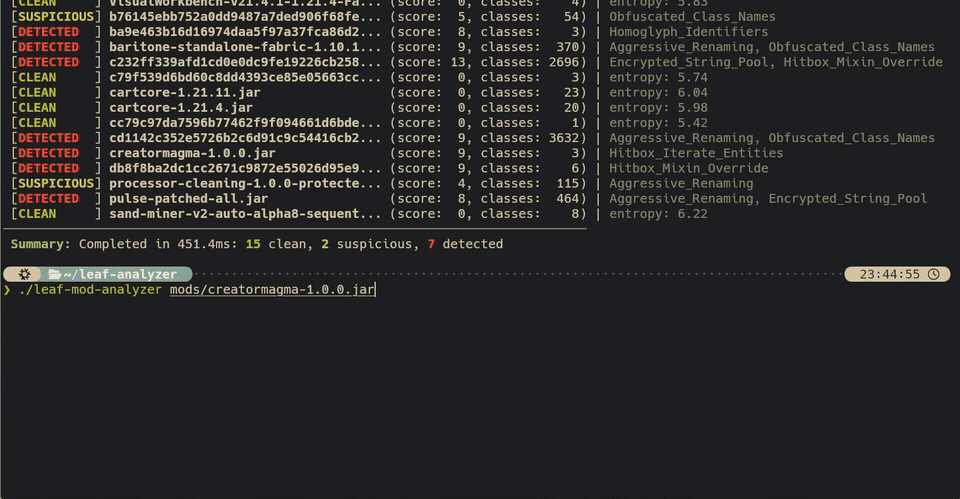
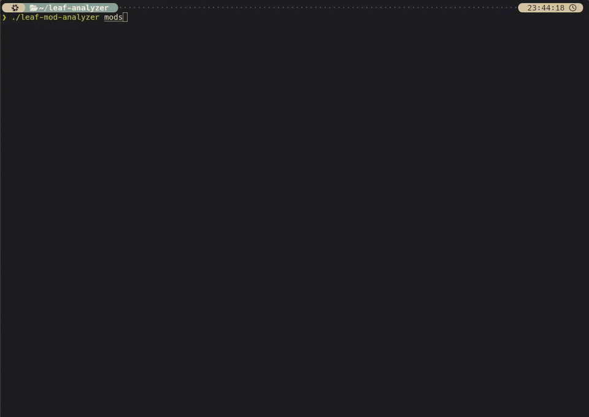

# 🍃 Leaf Mod Analyzer

> Fast, standalone static bytecode analyzer for Minecraft mods and cheats. No JVM or decompilation required.

> [!NOTE]
> This repository contains the **bare analysis core** (bytecode parser, heuristics, entropy calculator, and execution engine) without detection rules.
> Full analysis with complete, regularly updated detection rule sets is available online at **[mods.merud.online](https://mods.merud.online/)**.
> You can also supply your own custom rules using the `--rules <dir>` option.

---

## ⚡ Demo

### Single Mod Analysis


### Batch Scan (Directory)


---

## ✨ Features

- **No JVM Required**: Pure Rust bytecode parser and rule engine. Runs instantly without Java installed.
- **Deep Heuristics**: Detects obfuscation, aggressive renaming, homoglyph identifiers, string pool encryption, and bytecode entropy.
- **Extensible Rule Engine**: Supply your own detection rules via `--rules <dir>` in JSON format.
- **Blazing Fast**: Analyzes dozens of complex JARs in hundreds of milliseconds using parallel multithreading.
- **Zero Dependencies**: Single standalone binary for Linux and Windows.

---

## 🚀 Quick Start

### Basic Usage

```bash
# Scan a single mod JAR
leaf-mod-analyzer path/to/mod.jar

# Scan an entire directory of mods (batch mode)
leaf-mod-analyzer path/to/mods/

# Scan using custom detection rules
leaf-mod-analyzer --rules path/to/rules/ path/to/mods/
```

### Exit Codes

| Code | Meaning |
|:---:|:---|
| `0` | Scan completed successfully (clean / verified / suspicious / detected) |
| `1` | Scanner error or invalid arguments |

---

## 🛠️ Building from Source

### Using Cargo

```bash
cargo build --release
```

Binary will be available at `target/release/leaf-mod-analyzer`.

### Cross-Compilation (Linux & Windows)

```bash
# Linux x86_64
cargo build --release --target x86_64-unknown-linux-gnu

# Windows x86_64
cargo build --release --target x86_64-pc-windows-gnu
```
